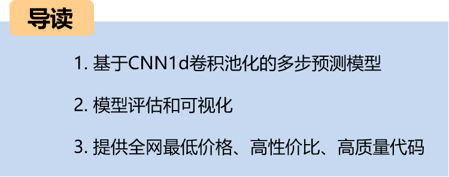
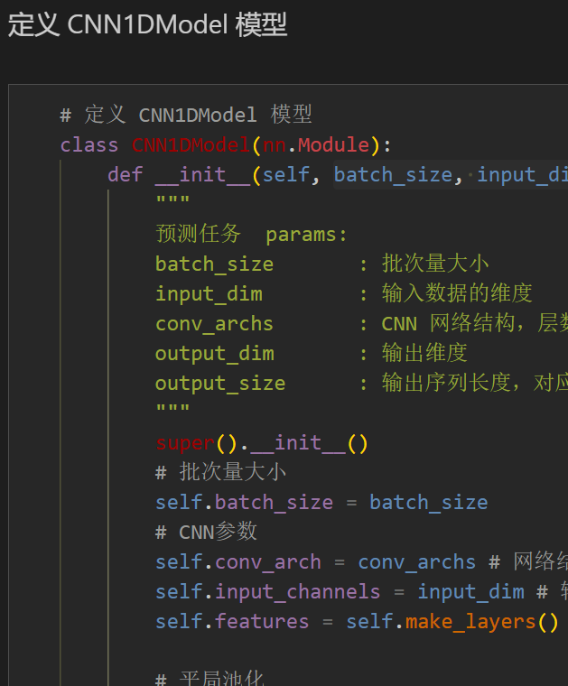
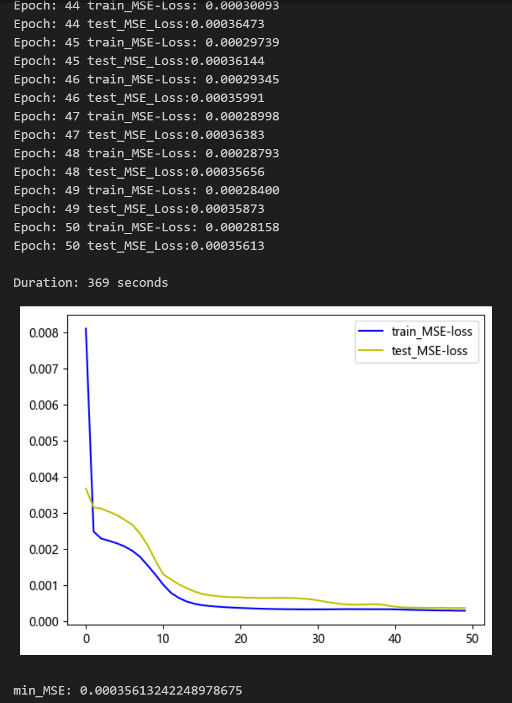
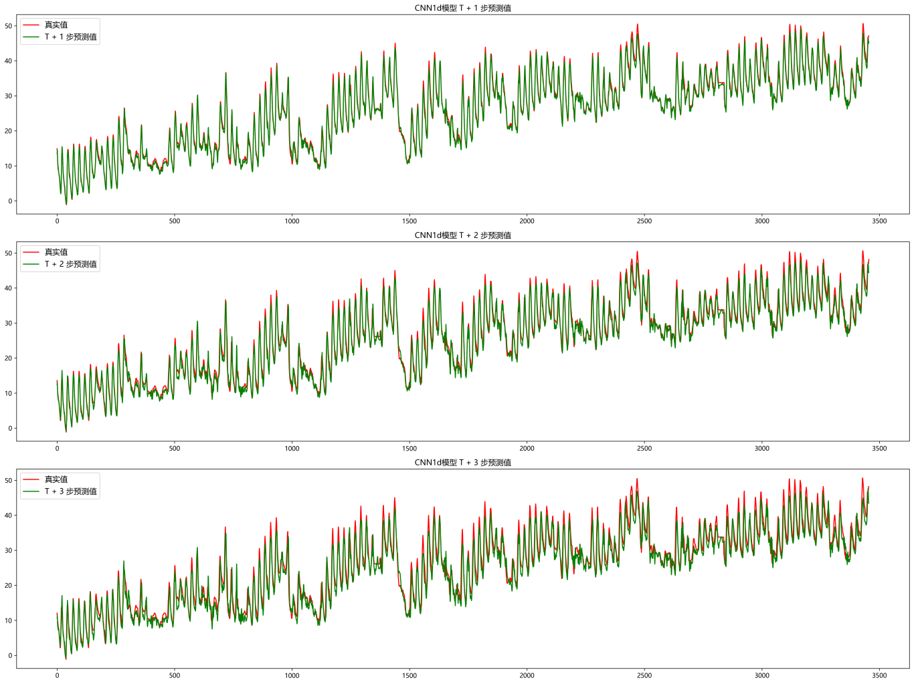
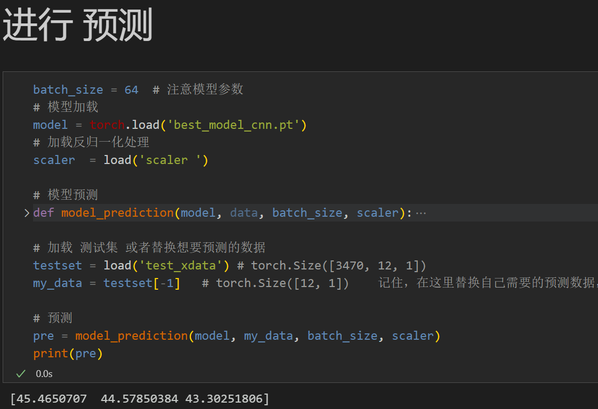
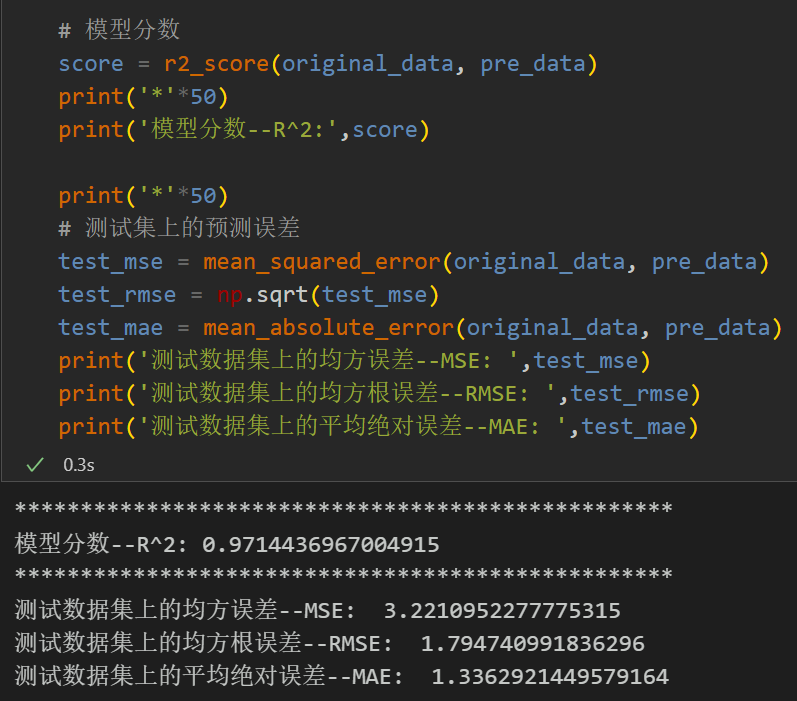
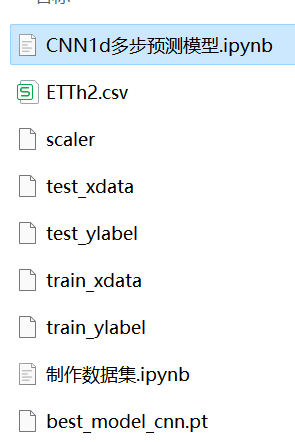

# Multi-step Prediction Model Based on CNN1d

Including complete process data code processing: multi-step prediction dataset creation, data loading, model definition, parameter setting, model training, model testing, prediction visualization, multi-step prediction, model evaluation.
Code and file introductions are provided:
Preface
This article is based on the previously introduced power transformer (data set attached at the end of the text) and introduces a multi-step prediction model based on CNN1d convolutional pooling.
The detailed introduction to the power transformer dataset can be found in the following text:
Introduction to the Power Transformer Dataset and Preprocessing
1 Data Preprocessing and Visualization of Electric Power Transformers
1.1 Import data
1.2 Multi-step Preprocessing for Prediction
2. Multi-step Prediction Model Based on CNN1d
2.1 Define the CNN1d network model
\t  
2.2 Set parameters and train the model
50 epochs, MSE is 0.000356. The CNN1d multi-step prediction model has significant predictive effects. The model can fully extract the spatial features of sequences, converges quickly, and performs excellently with high accuracy in predictions. By appropriately adjusting the model parameters, further improvements in model prediction performance can be achieved.
\tNote: Adjust parameters.
\tIt is appropriate to increase the number of CNN layers and the number of channels per layer, and fine-tune the learning rate.
\tIncrease more epochs (note to prevent overfitting)
\tThe sliding window length can be changed (set the appropriate window length).
3 Results Visualization and Prediction, Model Evaluation
3.1 Visualization of Prediction Results
3.2 Load the model for prediction
3.3 Model Evaluation
Click to download: Complete original data, Python code
Previously Featured Content:
Time Series Forecasting: Analysis and comparison of LSTM, ARIMA, Holt-Winters, SARIMA models
Wind Speed Prediction (Part 1) Data Set Introduction and Preprocessing
Wind Speed Prediction (II) EMD-LSTM Model Based on Pytorch
Wind Speed Prediction (III) EMD-LSTM-Attention Model
Wind Speed Prediction (IV) EMD-Transformer Model Based on PyTorch
Wind Speed Prediction (V) EMD-CNN-LSTM Model Based on PyTorch
Wind Speed Prediction (VI) EMD-CNN-GRU Parallel Model Based on PyTorch
CEEMDAN + Combination Prediction Model (BiLSTM-Attention + ARIMA)
CEEMDAN + Combination Prediction Model (CNN-LSTM + ARIMA)
CEEMDAN + Combination Prediction Model (Transformer - BiLSTM + ARIMA)
CEEMDAN + Combination Prediction Model (CNN-Transformer + ARIMA)
Multi-Feature Variable Sequence Prediction (I) - CNN-LSTM Wind Speed Prediction Model
Multi-Feature Variable Sequence Prediction (II) - CNN-LSTM-Attention Wind Speed Prediction Model
Multi-Feature Variable Sequence Prediction (III) - CNN-Transformer Wind Speed Prediction Model
Multi-Feature Variable Sequence Prediction (IV) Transformer-BiLSTM Wind Speed Prediction Model
Multi-Feature Variable Sequence Prediction (V) CEEMDAN+CNN-LSTM Wind Speed Prediction Model
Multi-Feature Variable Sequence Prediction (VI) CEEMDAN+CNN-Transformer Wind Speed Prediction Model
Prediction Model Based on SSA Optimized by Sparrow: CEEMDAN-BiLSTM-Attention
Prediction Model Based on SSA Optimized by Sparrow: CEEMDAN-Transformer-BiGRU
Superior Prediction Model: Secondary Decomposition-Combination Prediction
Multi-Feature Variable Sequence Prediction (VII) CEEMDAN+Transformer-BiLSTM Prediction Model
Multi-feature Variable Sequence Prediction (8) CEEMDAN-SSA-BiLSTM Prediction Model Based on Sparrow Optimization Algorithm
Multi-feature Variable Sequence Prediction (11) TCN-GRU Prediction Model Based on Pytorch
VMD + CEEMDAN Secondary Decomposition, CNN-LSTM Prediction Model
VMD + CEEMDAN Secondary Decomposition, CNN-Transformer Prediction Model
VMD + CEEMDAN Secondary Decomposition, Transformer-BiGRU Prediction Model
Prediction Model Based on Sparrow Optimization Algorithm SSA - Complete Code Kit
Introduction to the Power Transformer Data Set and Preprocessing
 | Sci-Tech 1st Class High Innovation Prediction Model!
END
2. Friends who like this can click to follow, give "Attention" to the article, share in the circle or discuss groups.

## Images

<!-- PAYMENT_BLOCK -->

## Get this dataset

- Payment link (Stripe): [Buy now](https://buy.stripe.com/3cs8yP7sY87d0vu9AB)
- Payment QR code: 

<!-- /PAYMENT_BLOCK -->
